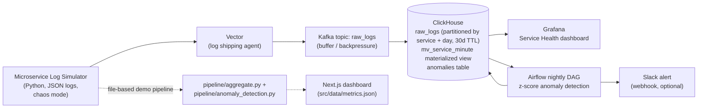

# Observability & Log Analytics Data Platform

[](https://github.com/saurabh7-coder/observability-log-analytics-platform/actions/workflows/ci.yml)


**DataOps engineering · Vector + Kafka + ClickHouse + Grafana + Airflow anomaly detection**

Simulates a fleet of microservices emitting logs and metrics, and builds the data platform that
ingests, stores, and analyzes them at scale — the same category of system that powers an internal
Datadog/Splunk at any tech company. Logs are shipped with **Vector**, buffered in **Kafka**, and land
in **ClickHouse** (a columnar OLAP store built for exactly this workload), where a nightly **Airflow**
job runs statistical anomaly detection on error-rate and latency trends and a **Grafana** dashboard
exposes it all live. A lightweight **Next.js dashboard** (this repo's root app) renders the same
metrics and deploys to Vercel in one click-import.

## Architecture



```
 simulator ──► Vector ──► Kafka ──► ClickHouse ──► Grafana
 (8 services,                │        │  ├─ raw_logs (MergeTree, partition by service+day, TTL 30d)
  chaos mode)                │        │  ├─ mv_service_minute (error rate / p95 rollups)
                             │        │  └─ anomalies (written by Airflow job)
                             │        └─ Kafka engine table + MV streams rows into raw_logs
                             └─ Airflow (nightly 01:15): rolling 30-min z-score on error rate
                                → anomalies table / CSV → Slack webhook alert
```

## Tech stack

| Layer | Tools |
|---|---|
| Log generation | Python simulator, structured JSON, 8 services, injectable chaos bursts |
| Shipping | Vector (file source → remap → Kafka sink) |
| Buffer | Apache Kafka (KRaft mode in Compose) |
| Storage / query | ClickHouse — partitioned raw table, Kafka engine table, materialized views |
| Anomaly detection | Python (pandas) rolling 30-min z-score on error rate **and** p95 latency, threshold 3, written back to ClickHouse |
| Orchestration | Apache Airflow DAG, nightly, with optional Slack webhook alert |
| Dashboards | Grafana (ClickHouse datasource, provisioned) + Next.js dashboard (Vercel) |

The 8 simulated services: `api-gateway`, `auth-service`, `checkout-service`, `payment-service`,
`inventory-service`, `search-service`, `notification-service`, `recommendation-service`.

## Run the pipeline locally (no Docker needed)

```bash
pip install -r requirements.txt

# 1. Generate 6 hours of logs (seed 42). TWO chaos scenarios are on by default:
#    a) error burst: checkout-service, minutes 200-234 - error rate ~42%, latency ~3.8x
#    b) latency degradation: payment-service, minutes 290-319 - latency ~4x,
#       errors only slightly elevated ("slow, not down"; --no-latency-chaos disables it)
python3 simulator/log_simulator.py --mode batch --minutes 360 --out data/logs.jsonl

# Try your own incident:
# python3 simulator/log_simulator.py --mode batch --minutes 360 \
#   --chaos-service payment-service --chaos-start 120 --chaos-duration 20

# 2. Aggregate -> data/minute_metrics.csv, data/service_summary.csv,
#    src/data/metrics.json (totals + SLO + per-service timeseries),
#    src/data/log_sample.json (300-log sample for the log explorer)
python3 pipeline/aggregate.py

# 3. Detect anomalies -> data/anomalies.csv (with `type`: error_rate | latency),
#    merged into src/data/metrics.json
python3 pipeline/anomaly_detection.py

# 4. Tests (synthetic, fast - no dataset needed)
python3 -m pytest tests/ -q

# 5. Dashboard
npm install
npm run dev        # http://localhost:3000   (or: npm run build && npm start)
```

### Verified results on the seed-42 demo dataset

| Metric | Value |
|---|---|
| Total logs generated | **67,199** |
| Total errors | **1,319** |
| Overall error rate | **1.963%** |
| Overall p95 latency | **229.76 ms** |
| Overall avg latency | **104.87 ms** |
| Uptime vs SLO target 99% | **98.037% — SLO missed, error budget remaining 0.0%** |
| Anomalies detected | **16 — 6 error-rate + 10 latency** |
| Top error-rate anomaly | **checkout-service, 2026-11-25 03:20 UTC — error rate 42.105%, z-score 15.74, p95 874.66 ms** |
| Top latency anomaly | **checkout-service, 2026-11-25 03:20 UTC — p95 874.66 ms vs baseline mean 222.07 ms, z-score 20.84** |
| Top payment-service latency anomaly | **2026-11-25 04:50 UTC — p95 1,063.90 ms vs baseline mean 301.86 ms, z-score 11.39** |

Both incidents are caught. The checkout error burst (minutes 200–234) produces 3 error-rate and
5 latency anomalies; the payment latency degradation (minutes 290–319, window p95 **1,300.5 ms**
vs a **310.8 ms** baseline ≈ 4.2×, window error rate 8.49% vs 2.08% baseline) produces 5 latency
anomalies in its opening minutes — exactly the "slow, not down" incident an error-rate-only
detector would miss.

**Detection method & tuning:** per service, each minute is compared with the rolling baseline of
the previous 30 minutes; a minute is flagged at z ≥ 3.0 with ≥ 10 requests that minute. Two
absolute floors sit on top of the textbook z-score rule, both tuned on this dataset:

- *Error rate ≥ 20%:* with only 12–45 requests per service-minute, 1–2 chance errors swing a
  minute by 7–14 points and the raw z-score alone flagged ~71 minutes, almost all noise; the
  floor (a real burst sits at ~42%) keeps the genuine detections.
- *p95 > 2.5× rolling baseline median (latency detector):* started at 1.8×, which flagged 7
  noise minutes on low-traffic services whose per-minute p95 is dominated by single-request
  tails. At 2.5× every latency flag sits inside a real chaos window and the noise is gone.

One honest side effect, kept deliberately: the latency scenario's slightly elevated error rate
(~6.5% by design on ~15 requests/minute) spiked 3 individual payment-service minutes to 20–25%
by chance, and the error detector flags them. The measurements are real — and a textbook
small-sample lesson in why a second, latency-based detector matters.

The SLO numbers are computed honestly from the same run: uptime is 100 − error rate, and the
error budget remaining vs the 99% target is `max(0, (1 − error_rate / 1%)) × 100` — with a
1.963% error rate the 1% budget is exhausted, so the dashboard shows **0% remaining** and
"SLO missed" rather than dressing it up.

## What's new — enhancements

- **Second chaos scenario + latency detector (pipeline):** the simulator now injects a
  payment-service latency degradation (minutes 290–319, ~4× latency, errors only slightly
  elevated) alongside the checkout error burst, and `pipeline/anomaly_detection.py` runs a
  second detector — rolling z-score on per-service p95 latency with a 2.5× median floor.
  Every anomaly is tagged `type: error_rate | latency` in `data/anomalies.csv` and the
  dashboard JSON.
- **Richer aggregation:** `pipeline/aggregate.py` also exports per-service timeseries
  (`service_timeseries` in metrics.json), a 300-log sample with trace IDs for the log
  explorer (`src/data/log_sample.json`), and an SLO summary in totals (uptime %, 99% SLO
  target, error-budget remaining — computed honestly, see above).
- **Dashboard:** per-service drill-down (click a Service Health row or use the selector),
  a client-side **live stream mode** (new chart point + log line every ~1.5 s, derived from
  service baselines), a **log explorer** (service/level filters + text search over endpoint,
  message and trace ID), an **SLO cards row**, and anomaly types in the anomalies table.
- **Tests + CI:** a pytest suite (`tests/`) covering simulator determinism/schema/chaos and
  both detectors on synthetic data — 8 tests, all passing — and a GitHub Actions workflow
  (`.github/workflows/ci.yml`) that runs pytest and the Next.js build on every push/PR.
- **Grafana:** the Service Health dashboard gains "Latency Anomalies (highest p95)" and
  "Per-Service p95 Latency (table)" panels (10 panels total).

## Run the full stack with Docker Compose

```bash
docker compose up -d
```

| Service | Address | Notes |
|---|---|---|
| Grafana | http://localhost:3001 | login `admin` / `admin`; "Service Health" dashboard is pre-provisioned |
| ClickHouse HTTP | http://localhost:8123 | schema from `clickhouse/schema.sql` is applied on first start |
| Kafka | localhost:9092 | KRaft mode, topic `raw_logs` (created by Vector/ClickHouse on first use) |
| Vector | — | tails `data/logs.jsonl` (shared volume) into Kafka |
| Simulator | — | streams logs continuously (1 simulated minute every 2 s) |

Airflow is not in Compose by default (it is heavy for a demo); run the DAG from
`airflow/dags/anomaly_detection_dag.py` in any Airflow 2.x install, or simply run
`pipeline/anomaly_detection.py` directly — the DAG wraps exactly that script and posts to Slack
when `SLACK_WEBHOOK_URL` is set.

The dashboard also has a **“Replay chaos scenario”** button that re-injects the recorded incident
into the charts client-side — the brief's suggested trick for live demos when the full stack is
not running 24/7 — plus a **live stream mode** that appends simulated live points and log lines,
a per-service drill-down, and a log explorer for demoing exploration workflows.

## Deployment (your own accounts)

This project is account-agnostic: no credentials, tokens or environment variables are baked in.
Deploy it from **your own** GitHub and Vercel accounts:

### 1. Push to a new GitHub repo (under your account)

```bash
cd observability-platform
git init
git add .
git commit -m "Observability & Log Analytics Data Platform"
git branch -M main
# Create an empty repo named e.g. `observability-log-analytics-platform`
# on github.com under YOUR account (no README/.gitignore - this repo has them),
# then:
git remote add origin https://github.com/<your-username>/observability-log-analytics-platform.git
git push -u origin main
```

(`data/logs.jsonl`, `node_modules/` and `.next/` are git-ignored; the generated
`src/data/metrics.json` and CSVs **are** committed, so the dashboard shows real data immediately.)

### 2. Deploy on Vercel (under your account)

1. Go to [vercel.com](https://vercel.com) → sign in with **your** account → **Add New → Project**.
2. Import the GitHub repo you just pushed (install the Vercel GitHub app on your account/repo if asked).
3. Framework preset: **Next.js** (auto-detected). **Root Directory: the repo root** (leave as `./`).
4. **No environment variables are needed.** Click **Deploy**.
5. Open the deployment URL — the dashboard, `/api/metrics` and `/api/health` are live.

To refresh the data later: re-run the three pipeline commands above, commit the updated
`src/data/metrics.json`, and push — Vercel redeploys automatically.

## Project structure

```
simulator/log_simulator.py        JSON log generator (batch + stream, two chaos scenarios)
pipeline/aggregate.py             logs.jsonl -> minute metrics + dashboard JSON + log sample
pipeline/anomaly_detection.py     rolling z-score detection (error rate + latency) -> anomalies.csv + JSON
clickhouse/schema.sql             raw_logs / Kafka table+MV / mv_service_minute / anomalies
airflow/dags/anomaly_detection_dag.py   nightly DAG + Slack alert
vector/vector.yaml                file -> Kafka shipping config
grafana/                          ClickHouse datasource + Service Health dashboard (provisioned)
docker-compose.yml                Kafka + ClickHouse + Vector + Grafana + simulator
src/                              Next.js 14 dashboard (app router, inline-SVG charts, API routes)
src/data/metrics.json             pipeline output: totals + SLO, series, per-service timeseries, anomalies
src/data/log_sample.json          300-log sample powering the log explorer (/api/logs)
tests/                            pytest suite (simulator + anomaly detection, synthetic data)
.github/workflows/ci.yml          CI: pytest + Next.js build on push/PR
data/                             generated CSVs (logs.jsonl is git-ignored)
```

## Resume bullet

> *Designed a log-analytics platform ingesting structured microservice logs through Vector and Kafka
> into ClickHouse, with nightly Airflow-scheduled anomaly detection on error-rate trends surfaced via
> a live Grafana dashboard and Slack alerts.*

## Interview talking points

- **Why ClickHouse over a row store?** Log analytics is aggregate-heavy (counts, quantiles, error
  rates over time ranges). A columnar store reads only the columns a query needs, compresses
  repetitive log fields extremely well, and scans billions of rows fast — a row-oriented OLTP
  database would read whole rows and is built for point lookups, not scans.
- **How Kafka protects ClickHouse:** during a traffic/error burst, producers (Vector) write to
  Kafka at line rate and ClickHouse consumes at its own pace via the Kafka engine table — the
  topic is the shock absorber (backpressure), so ingestion spikes never become failed writes.
- **Threshold choice & trade-offs:** z ≥ 3 over a 30-minute rolling baseline ≈ a 3-sigma rule.
  Lowering it catches smaller incidents sooner but flags normal noise (false positives → alert
  fatigue); raising it misses short/soft degradations (false negatives). The 20% absolute floor
  and the ≥10-requests guard are deliberate extra protection against small-sample noise.
- **Extending to distributed tracing:** propagate the `trace_id` already present in every log line,
  emit spans (service, operation, start/duration, parent span id) to a spans table in ClickHouse
  keyed by trace_id, and join logs ↔ spans so one click goes from an anomalous minute → the
  offending traces → the exact span that slowed down.

## Why this project stands out

ClickHouse is one of the fastest-growing OLAP engines in industry (used by Uber, Cloudflare, Cisco)
and is rarely seen in student projects; log/observability platforms sit at the intersection of data
engineering and DevOps, widening the set of roles you can credibly interview for — and a dashboard
that shows a live error-rate spike with an automatically detected anomaly window is a genuinely
impressive thing to drive during an interview call.
